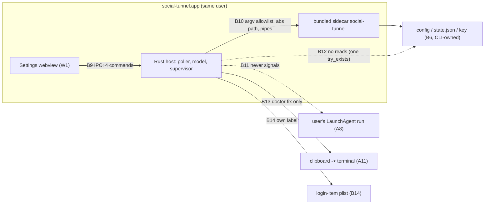

# Tray app (v0.2) threat model

Status: **scoped, design-time**. Extends [the v0.1 model](../../../docs/security/threat-model.md)
(T1-T12, B1-B8, A1-A7, actors S1/S2/N1/H1/D1/P1); those rows are not repeated and stay as they are.
New threat IDs continue at T13. No `app/` code exists yet, so every "existing control" is a plan
criterion with its check, not verified enforcement. Baseline: `main` at `3093c8a`.

## Scope and evidence

- In scope: the v0.2 tray app as planned in [plan.md](plan.md) (Flow L21-32, Surface, Landing doors
  3-9 L74-80, criteria 5-10, 13, 36-54, 75-82, Security Surfaces) and [checks.md](checks.md)
  (SEC-001..009). CLI evidence: `src/cli.ts:60-83` (argv parser: `--config`, `--domain`),
  `src/cli.ts:229-230` (inherits `process.env`), `src/config.ts:29-38` (`SOCIAL_TUNNEL_CONFIG`,
  `XDG_CONFIG_HOME`, `HOME` choose the config), `src/status.ts:24-58` (live run = state + pid alive +
  fresh `updatedAt`; pid comes from `state.json`), `src/doctor.ts:39-43,349` (`fix` text),
  `src/log.ts:10-12` (text mode strips control characters; `--json` does not).
- Runtime: Rust host process, one Settings webview (React, local `dist`), compiled CLI sidecar
  (`status`, `doctor`, `run`), clipboard, login item, the user's own LaunchAgent run.
- Build/dev: `bun build --compile` sidecar, `tauri build --bundles app`, `install-local.sh` copy to
  `~/Applications`. Unsigned and not notarized (plan Out of scope). Tests: fake sidecar script and
  fakes for clipboard and login item (checks.md Seams); fixtures are not runtime components.
- Excluded: the tunnel, proxy and server paths (unchanged CLI code, v0.1 model); setup assistant,
  config editing, updater, signing (plan Out of scope); same-user malware (v0.1 H1 limit: it already
  owns the key and can replace the app).

## Assets and objectives

| ID | Asset | Objective |
| --- | --- | --- |
| A3 | SSH private key (v0.1) | Never read, held, shown or logged by the app |
| A7 | Status truth (v0.1) | The tray shows what `status`/`doctor` report, never a forged row |
| A8 | The user's LaunchAgent run `tech.antoniofulg.social-tunnel` and its plist | Never signalled, duplicated or edited by the app |
| A9 | Process-start authority of the app | Only Rust starts processes, only the bundled sidecar, only allowlisted argv |
| A10 | Other processes of the user | The app signals no process it did not start |
| A11 | User's terminal via the clipboard | Copy Fix places only doctor's own fix text, safe to paste |

## Attackers

| Actor | Can | Cannot (assumed) |
| --- | --- | --- |
| W1: script running in the webview (via injected markup, a compromised npm dependency in the bundle, or remote content if loaded) | Call whatever the capability grants; navigate the window | Reach Rust except through granted IPC |
| C1: text in CLI output (config values, server-reported details, hostnames) | Put arbitrary strings into status/doctor JSON the app renders or copies | Change the app's argv or capability |
| H1 (v0.1): another local user | Read/write files whose mode allows it | Write the user's `~/Applications`, config or `state.json` (user-owned) |
| D1 (v0.1): malicious dependency (npm, crates, Bun) at build time | Run code in the build or ship it in the bundle | Out of runtime scope; lockfiles pinned (Security Surfaces S1) |
| U1: an unrelated process that reuses a pid | Hold a pid the app once spawned after that child exits | Pick the pid deliberately (assumed; macOS randomizes pids) |

## Trust boundaries

| ID | From -> to | Data | Control owner |
| --- | --- | --- | --- |
| B9 | Webview -> Rust (Tauri IPC) | 4 commands, `snapshot` event | capability + CSP (door 5, AC 5, 9) |
| B10 | Rust -> sidecar process | argv, env, exe path, stdout/stderr pipes | `SidecarCall` enum, path resolver (AC 6-8, 13, 48) |
| B11 | App -> processes it did not start (LaunchAgent run, reused pids) | signals | ownership rule (door 6, AC 36, 47) |
| B12 | App -> config/state/key files | none: the app reads nothing but one `try_exists` | AC 10; the CLI owns B6 |
| B13 | Doctor JSON -> clipboard -> user's terminal | `fix` text | `copy_fix(hop)` (AC 52, 54) |
| B14 | App -> `~/Library/LaunchAgents` (login item) | a plist with its own label | `tauri-plugin-autostart` (door 7, AC 78, 79) |
| B15 | Build -> unsigned bundle -> `~/Applications` | binaries | lockfiles, `externalBin`, `install-local.sh` (door 3, AC 75, 80, 81) |

## Threats

L / I = likelihood / impact (l/m/h); P = priority. Controls are planned criteria and checks.

| ID | Actor -> boundary | Abuse path | Asset | Existing control | L / I | P | Gap |
| --- | --- | --- | --- | --- | --- | --- | --- |
| T13 | W1 -> B9 | Webview script spawns a process, reads a file, or passes its own argv through a plugin permission | A9, A3 | No plugin permission in the webview, four typed commands (AC 5, C5, SEC-001); argv from enum (AC 6-7, C6-C7) | m / h | High | none |
| T14 | W1 -> B9 | Remote script/style/frame loads, or the window navigates to a remote page (phishing UI in an app the user trusts; a page that later gains IPC if a capability ever adds `remote`) | A9, A7 | CSP (AC 9, C9, SEC-002); no remote capability (C9); dist has no remote URL (C74) | l / m | Medium | **CSP does not stop top-level navigation or `window.open`.** New AC 84, C84 |
| T15 | C1 -> B9 | Config- or server-supplied text injects markup into Settings or forges menu rows | A7, A9 | Text rendered as text, rows cut at 60 (AC 30, 73; C30, C73; SEC-006) | l / m | Low | none |
| T16 | W1, C1 -> B10 | Argument injection: a host or path starting with `-`, NUL or whitespace becomes a CLI flag | A9 | Typed builder and rejections (AC 6-7, C6-C7, SEC-001); CLI parser takes only `--config`/`--domain` values (`src/cli.ts:70-74`) | l / h | Medium | none |
| T17 | H1, D1 -> B10 | A `social-tunnel` earlier on `PATH` or in the working directory runs instead of the bundled sidecar | A9, A3 | Absolute path next to the app executable (AC 8, C8, C75, SEC-003) | l / h | Low | none |
| T18 | env -> B10 | The sidecar inherits the app's env; a different `SOCIAL_TUNNEL_CONFIG`/`XDG_CONFIG_HOME` than the LaunchAgent's makes the app watch another config and start a second run | A8, A7 | `run.lock` per config dir (AC 38); app and LaunchAgent both start from launchd's user env | l / l | Low | Residual: no env pinning; same-user only. No criterion |
| T19 | C1 -> B10 | A child floods stdout/stderr, or `status` hangs or prints huge output, and the poller or supervisor stalls (tray lies, tunnel stops relaying) | A7, A6 | 10 s timeout and 1 MiB cap on status (AC 13, C13); pipes drained (AC 48, C48, SEC-009); doctor 120 s kill (AC 51, C51) | l / m | Low | Residual: no size cap on doctor stdout (self-impact only) |
| T20 | H1 -> B11 | Forged or stale `state.json` pid makes the app signal another process | A10, A8 | App signals only pids it spawned; status pid only watched (door 6, AC 36, 47; C36, C47; SEC-005); `isLiveRun` checks freshness (`src/status.ts:24-25`) | l / h | Medium | none |
| T21 | U1 -> B11 | **Pid reuse**: the app's child exits and is reaped, the pid is reused, then Reconnect or Quit sends SIGTERM/SIGKILL to the recorded pid. AC 47 holds (the pid was spawned by the app) yet an unrelated process, possibly the LaunchAgent run, is killed | A10, A8 | AC 44, 46, 47 allow it; C47 checks pids, not liveness | l / h | Medium | **New AC 83, C83**: signal only through the live child handle, never after its exit was observed |
| T22 | app -> B11 | The app starts a second run beside the LaunchAgent's | A8 | No spawn while an external run is live (AC 36-38, C36, C38, C82, SEC-005) | m / l | Low | none |
| T23 | W1 -> B12 | App reads the key or config (key on screen, second config parser) | A3 | No fs calls in Rust (AC 10, C10, SEC-004); Settings shows path and fingerprint (C65); no `fs:` permission (C5) | l / h | Low | none |
| T24 | W1 -> B13 | Webview puts arbitrary text on the clipboard | A11 | `copy_fix` takes a hop name, copies doctor's `fix` only (AC 52, 54; C52, C54; SEC-007) | l / h | Low | none |
| T25 | C1 -> B13 | Doctor's `--json` `fix` holds a newline, ESC or other control character (from a config value or server-reported detail); pasted into a terminal it runs a command or rewrites the screen. Text mode strips these (`src/log.ts:10-12`), JSON does not | A11 | AC 52 copies byte for byte | l / h | Medium | **New AC 85, C85**: refuse a fix holding a control character (`no_fix`) |
| T26 | app -> B14 | The login item overwrites or edits the user's LaunchAgent plist, or points at a build-directory binary | A8 | Different label, plist hash unchanged, program inside `~/Applications` (door 4, 7; AC 78, 79; C78, C79; SEC-008) | l / h | Low | none |
| T27 | D1, H1 -> B15 | Compromised dependency ships in the bundle; the unsigned bundle in `~/Applications` is swapped | A9, A3 | Pinned lockfiles, sidecar built from repo source (Security Surfaces S1, SEC-003, AC 3, 75); H1 cannot write the user's `~/Applications` | l / h | Low | Residual: no signature or notarization (plan Out of scope); same-user replacement out of scope |
| T28 | W1 -> B9 | DevTools or a debug build exposes a console that calls IPC | A9 | Release build; console only reaches the same 4 commands (AC 5) | l / l | Low | Residual: none needed |

## Mitigations added (recommended controls)

| Threat | Owner | Change | Verification |
| --- | --- | --- | --- |
| T21 | `supervisor` | AC 83: signal a child only through its live process handle; after its exit is observed, send nothing to that pid | C83: fake runner reports exit, then Reconnect and Quit make zero signal calls |
| T14 | Settings window builder | AC 84: block navigation outside the app origin and refuse new windows | C84: Rust navigation policy denies `https://example.com` and allows the app origin; new-window handler denies |
| T25 | `copy_fix` | AC 85: a fix holding a control character returns `no_fix`, no clipboard write | C85: fixes with `\n`, `\x1b`, `\r`, `\x7f` give `no_fix` and zero writes |

## Assumptions and coverage

- Assumed (not asked; delegated by the user 2026-11-22): one local macOS user; same-user malware out
  of scope; pids not attacker-chosen; the bundle ships no remote content. If any changes, T14, T21
  and T27 rise.
- Coverage: B9-B15 each map to threats above; tray native menu has no webview (covered by T15 via
  AC 30). Prior T1-T12: unchanged, not reclassified (no CLI tunnel or proxy code changes in v0.2;
  door 1-2 additions are read-only output, T10's forged pid is handled by T20).
- Counts: 16 new threats (T13-T28); 3 gaps closed by new criteria 83-85; 3 residual (T18, T19,
  T27) accepted as low.
