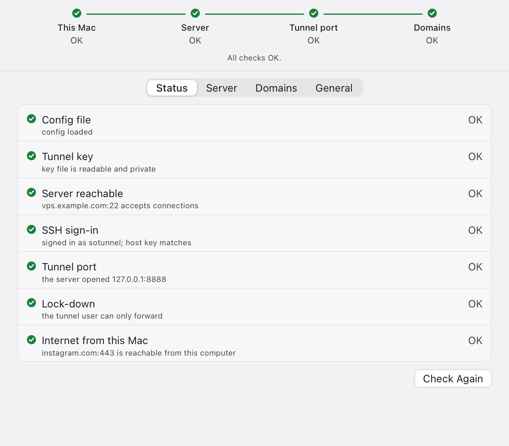
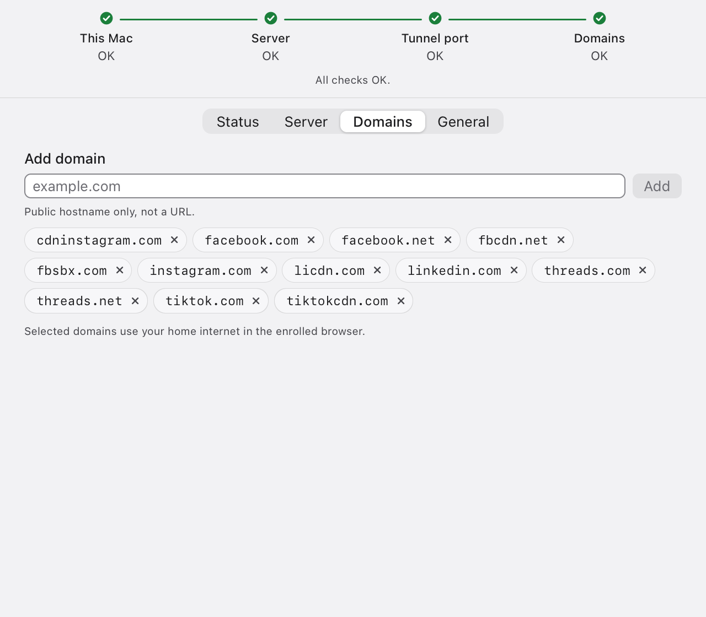
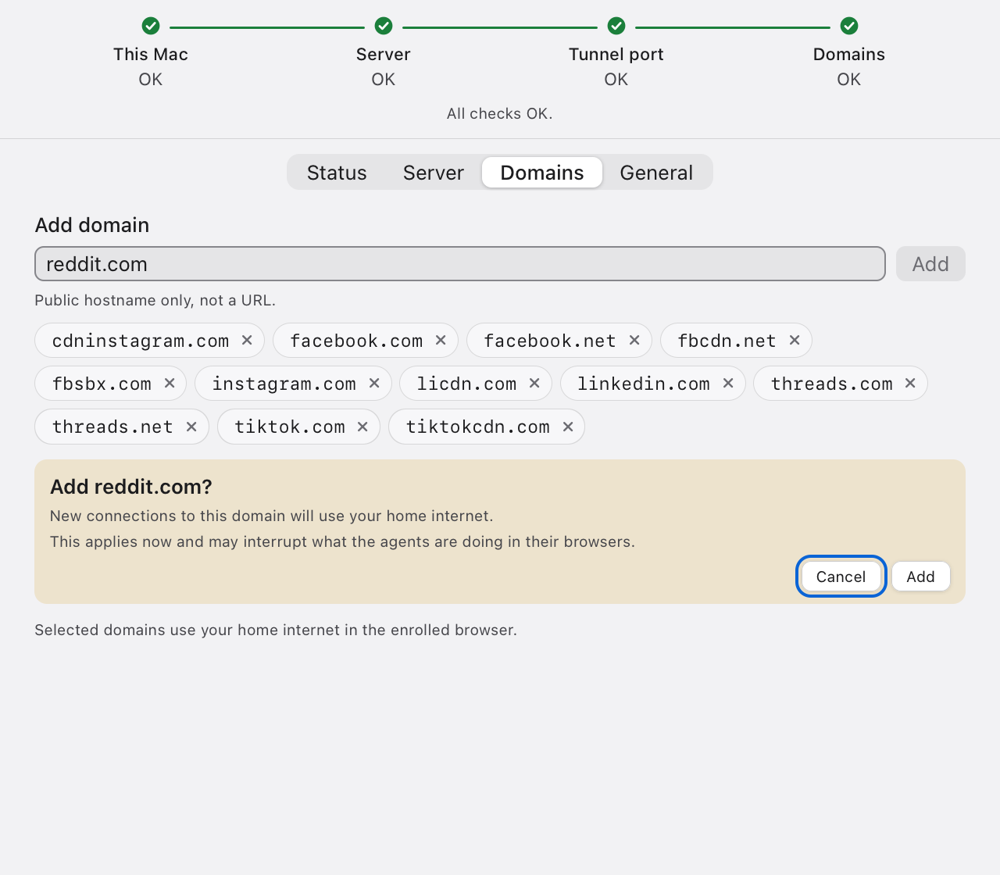

# social-tunnel

Let AI agents on a server reach social platforms through your home internet.

Instagram, Facebook, Threads, LinkedIn and TikTok often block or challenge logins from datacenter IPs, so an AI agent driving a browser on a VPS cannot use those accounts. `social-tunnel` routes **only the domains you choose** from the server's browser through a computer at home, over an SSH reverse tunnel. Everything else keeps going out directly from the server.

<picture>
  <source media="(prefers-color-scheme: dark)" srcset="docs/images/status-dark.png">
  
</picture>

## How it works

```
 VPS                                              home computer
 ┌───────────────────────────────┐                ┌──────────────────────────────────┐
 │ agent's Chrome                │                │ social-tunnel run                │
 │   PAC: chosen domains ──┐     │   SSH reverse  │   allowlist proxy (in-process)   │
 │   everything else       │     │     tunnel     │     only chosen domains, :443    │──▶ internet,
 │   goes direct           ▼     │ ◀═════════════ │     never the home network       │    home IP
 │            127.0.0.1:8888 ────┼───────────────▶│                                  │
 └───────────────────────────────┘                └──────────────────────────────────┘
```

1. On the home computer, `social-tunnel run` opens an SSH connection to the server as a dedicated tunnel user and asks the server to listen on `127.0.0.1:8888`.
2. On the server, Chrome uses a mandatory PAC that sends only the chosen domains to `127.0.0.1:8888`. Everything else goes out directly, as before.
3. Each connection on that port travels through the tunnel to the home computer. The built-in proxy accepts only `CONNECT <allowlisted host>:443`, resolves the name at home, refuses any private or home-network address, and relays the encrypted bytes. It never sees inside HTTPS.

The SSH client and the proxy are built in: the home computer needs neither `ssh` nor tinyproxy.

## The app

A macOS menu bar app keeps the tunnel running and shows where it breaks. **Settings** checks every hop from this Mac to the server and names the first broken one with a fix.

With the [protected server package](server/linux/README.md) installed, the **Domains** tab edits the list that the server's Chrome sends home. An edit applies immediately, after you confirm, because it can interrupt what the agents are doing in their browsers. The app reports a change as applied only after the server's own Chrome proves the new route.

<table>
  <tr>
    <td>
      <picture>
        <source media="(prefers-color-scheme: dark)" srcset="docs/images/domains-dark.png">
        
      </picture>
    </td>
    <td>
      <picture>
        <source media="(prefers-color-scheme: dark)" srcset="docs/images/domains-confirm-dark.png">
        
      </picture>
    </td>
  </tr>
</table>

## Safety rules

The home-side rules hold in code and are covered by tests. Failing closed and narrow server access depend on the server setup, which `doctor` checks.

- **Allowlist only.** The proxy refuses every host not on the list (`403`), every port other than 443, every IP literal and every plain-HTTP request (`405`). Lookalike names such as `evilinstagram.com` do not match `instagram.com`.
- **Never the home network.** If an allowlisted name resolves to a loopback, private, link-local, CGNAT, multicast or reserved address, or into a network the home computer is on, the proxy refuses it. It connects to the exact address it checked, so a second DNS answer cannot redirect it.
- **No open port at home.** The proxy runs inside the tunnel process and opens no listening socket.
- **Fails closed.** The PAC sends the chosen domains to the tunnel with no direct fallback. If the tunnel is down, those sites fail instead of switching to the datacenter IP.
- **Pinned server key.** The server's host key is pinned by its `SHA256:` fingerprint. There is no trust-on-first-use.
- **Narrow server access.** The tunnel user has no shell and may only listen on one loopback port. With the protected package, a kernel guard also stops every other process on the server, agents included, from taking that port.
- **You log in yourself.** The tool never asks for, stores or logs platform passwords, 2FA codes or cookies. The SSH private key stays on the home computer, readable only by you.

The full threat model is in [docs/security/threat-model.md](docs/security/threat-model.md).

## Status

**v0.2.** In daily use against one VPS with four agent environments.

| Piece | State |
| --- | --- |
| `run`, `status`, `doctor` | Done |
| macOS menu bar app | Done; unsigned, Apple Silicon |
| Domain editing (app and `domains` CLI) | Done; needs the protected server package |
| Protected server package (Linux) | Done; installed by hand as root |
| `setup` (key, server side, PAC) and `install` | Planned |
| Signed builds, npm and Homebrew | Planned |
| MCP server | Later |

## Install

### Home computer (macOS)

Download the `Social-Tunnel-<version>-macos-arm64.zip` from the [latest release](https://github.com/antoniofulg/social-tunnel/releases/latest), unzip it, and move **Social Tunnel.app** to `~/Applications`. The build is not signed: on first launch, right-click the app and choose **Open**. Turn on **Open at Login** in the menu bar menu.

From source, with [Bun](https://bun.sh) 1.4 or newer (macOS or Linux):

```sh
git clone https://github.com/antoniofulg/social-tunnel && cd social-tunnel
bun install
bun src/cli.ts --help
```

`cd app && bunx tauri build --bundles app` builds the app; `app/scripts/install-local.sh` installs it.

### Tunnel key

```sh
ssh-keygen -t ed25519 -N "" -C social-tunnel -f ~/.ssh/social_tunnel
chmod 600 ~/.ssh/social_tunnel
```

Use a key only for this. `doctor` warns if you point it at your personal `~/.ssh/id_*` key.

### Server

Pick one:

- **Basic tunnel**: a tunnel user, one `sshd` rule and a Chrome policy you edit by hand. See [docs/server-setup.md](docs/server-setup.md).
- **Managed domains**: the protected package, which adds editing from the app and the kernel port guard. See [server/linux/README.md](server/linux/README.md). The Linux binaries are on the release page.

### Config

`~/Library/Application Support/social-tunnel/config.json` on macOS, `~/.config/social-tunnel/config.json` on Linux. `--config <path>` or `SOCIAL_TUNNEL_CONFIG` overrides it.

```json
{
  "version": 1,
  "server": {
    "host": "your.server",
    "port": 22,
    "user": "sotunnel",
    "hostKey": "SHA256:abc123...43 characters, no padding"
  },
  "remotePort": 8888,
  "keyPath": "~/.ssh/social_tunnel",
  "domains": ["instagram.com", "facebook.com", "threads.net", "linkedin.com", "tiktok.com"]
}
```

| Field | Meaning |
| --- | --- |
| `server.host`, `server.port`, `server.user` | Where the tunnel user logs in |
| `server.hostKey` | The server's host key, `SHA256:` plus 43 base64 characters |
| `remotePort` | Loopback port the server listens on; default `8888` |
| `keyPath` | Private key file; `~` and paths relative to the config file work |
| `domains` | The allowlist. A domain covers its subdomains. Bare hostnames only |

Unknown fields are rejected, so a typo or a pasted secret never goes unnoticed. The config holds no secrets.

Then run `social-tunnel doctor`, start the app (or `social-tunnel run`), and log in to each platform yourself in the agent's browser on the server.

## CLI

| Command | Does |
| --- | --- |
| `social-tunnel run` | Holds the tunnel open and reconnects on its own. The app runs this for you |
| `social-tunnel status` | Reports the tunnel state |
| `social-tunnel doctor [--domain <host>]` | Tests every hop in order and names the first broken one with a fix |
| `social-tunnel domains list` | Shows the domains the server's Chrome currently sends home |
| `social-tunnel domains add <host> --expected-revision <n>` | Proposes adding a domain; applies immediately |
| `social-tunnel domains remove <host> --expected-revision <n>` | Proposes removing a domain; applies immediately |
| `social-tunnel domains retry <operation-id>` | Checks an earlier edit until it is applied |

Every command accepts `--json` (one JSON object on stdout) and returns without input. Exit codes are stable: `0` OK, `1` internal error, `2` usage, config or invalid input (such as a bad hostname), `10` tunnel or authority unavailable, `11` server refused the tunnel port, `12` domain not on the allowlist, `13` host key mismatch, `14` tunnel user too permissive.

| Tunnel state | Meaning |
| --- | --- |
| `connecting` | First connection in progress |
| `connected` | Tunnel up; chosen domains go through home |
| `disconnected` | Connection lost or key refused; `retryAt` says when it tries again |
| `reconnecting` | Trying again (1, 2, 4, 8, 16, then every 30 s) |
| `blocked` | The server refused the port (retried every 30 s) or presented a different host key (stops) |
| `stopped` | No `run` is active, or it serves another server than this config |

## For AI agents

[`skills/social-tunnel/SKILL.md`](skills/social-tunnel/SKILL.md) teaches a coding agent to check the tunnel and edit domains with the CLI. The CLI runs on the **home** computer. An agent on the server sees only whether its requests succeed: a chosen site that fails to load means the tunnel is down, by design.

## Troubleshooting

| Symptom | Check |
| --- | --- |
| `status` exits 10 | Is the app or `run` running at home, and online? `doctor` names the broken hop |
| `blocked` / exit 11 | Something else holds the port on the server, often a stale tunnel. It frees within about 90 s |
| Exit 13 | The server's host key changed. Verify the new fingerprint out of band before updating `server.hostKey` |
| Exit 14 | Tighten the tunnel user: `restrict`, `command=`, `ForceCommand` and `PermitOpen none` |
| Sites fail in Chrome but `status` is `connected` | Check `chrome://policy` on the server and restart the agent's Chrome |
| A platform loads but login breaks | It may use another domain for login or media. Add it |

## Limits

- Works only while the home computer is on and online. For 24/7 use, run it on an always-on device at home.
- Platforms may still restrict accounts used for automation. Prefer a secondary account and a human pace.
- Every process on the server that can reach `127.0.0.1:8888` can use the tunnel for the allowlisted domains. Keep the list short.

## Development

```sh
bun install
bun test
bun run typecheck
```

Tests need no internet and no `sshd`: they run an in-process SSH server and inject DNS and network fakes. Contributor and agent rules are in [AGENTS.md](AGENTS.md); feature specs, checks and verification records are under [.specs/](.specs/).

## License

[MIT](LICENSE)
