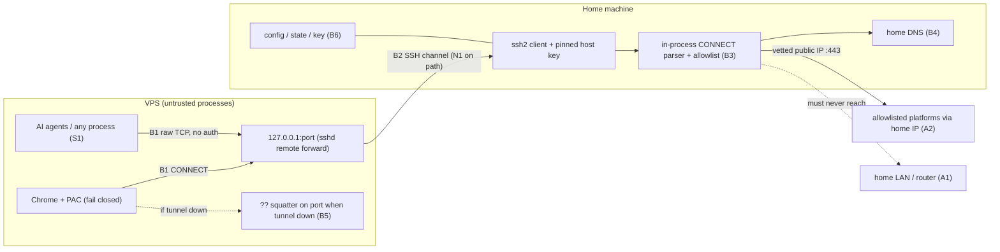

# social-tunnel v0.1 threat model

Status: **provisional**. This models the planned design; there is no code yet. Material assumptions were not confirmed with the user (see [Open questions](#open-questions)). Re-run the model when code lands or a trust boundary changes (`setup`, tray sidecar, MCP).

## Scope and evidence

- In scope: the v0.1 CLI runtime (`run`, `status`, `doctor`): the SSH client, the in-process allowlist proxy, DNS on the home side, config and state files, and the server-side surfaces the tunnel depends on (loopback port, tunnel user, PAC).
- Evidence: `README.md:5-19` (purpose, safety rules), `README.md:27-44` (v0.1 commands, stable exit codes, `--json`), `AGENTS.md:21-29` (safety invariants), and the coordinator's v0.1 draft plan (listed in this brief, not stored in the repo). There is no code, so there are no file/line citations for controls. Every "existing control" below is a **design commitment**, not verified enforcement.
- Out of the v0.1 runtime (boundary impacts noted only): `setup` (server provisioning with admin SSH), `domains add` (PAC sync), `install` (login services), the v0.2 Tauri tray, MCP, npm/Homebrew distribution and CI. Tests: none exist.
- Excluded: platform account security and the server's Chrome profile. Session cookies live on the server, and the tool never touches them (`AGENTS.md:29`). Any server process that can read that profile can already use the sessions without the tunnel.

## System model

Runtime:

1. **Home machine.** `social-tunnel run` (Bun binary, `ssh2`). It reads `~/.config/social-tunnel/config.json` (no secrets) and an ed25519 key file (0600). It writes a state file (pid and tunnel state) in the config dir.
2. **SSH hop.** Home connects outbound to the VPS as a no-shell tunnel user with key auth. It pins the server host key by SHA256 fingerprint and requests a remote forward `127.0.0.1:<remotePort>` (default 8888).
3. **Server.** sshd listens on `127.0.0.1:<port>` for the tunnel user. Chrome uses a PAC: allowlisted domains go to `PROXY 127.0.0.1:<port>` with no `DIRECT` fallback, and everything else goes direct. **Every other server process (AI agents with shell and tools) can also connect to that port.**
4. **Proxy handler (in-process, no local listener).** For each forwarded channel it parses one `CONNECT host:443`, checks the host against the allowlist (equal or subdomain), resolves DNS on the home side, rejects non-public IPs, connects to the vetted IP and pipes bytes. Anything else gets 403/405 and is closed.
5. **`status --json`** reads the state file. **`doctor --json`** actively tests config, key perms, TCP reach, SSH auth and host key, forward permission, and domain egress.

CI/build/dev: none yet. The planned `bun build --compile` and npm/Homebrew binaries are a future supply-chain boundary (T11).

## Assets and objectives

| ID | Asset | Objective |
| --- | --- | --- |
| A1 | Home LAN, router, and services on the home machine | Confidentiality and integrity: unreachable from the server |
| A2 | Home public IP reputation and attribution | Used only for allowlisted platforms, at a sane rate |
| A3 | Tunnel SSH private key (home) | Confidentiality; its capability on the server stays minimal |
| A4 | Social account standing | Fail closed: accounts never flip to the datacenter IP |
| A5 | Server integrity | The tunnel user cannot get a shell, files or other forwards |
| A6 | Home machine and bandwidth availability | Bounded CPU, memory, sockets and bandwidth |
| A7 | Config and state integrity | `status`/`doctor` tell the truth; agents act on that output |

## Attackers

| Actor | Can | Cannot (assumed) |
| --- | --- | --- |
| S1: any server process (prompt-injected agent, compromised service, other tenant) | Connect to `127.0.0.1:<port>`, send arbitrary bytes, open many connections. When the tunnel is down, bind that port (unprivileged, ≥1024). Pick names it controls if the allowlist covers them | Read the home key. Bypass the home proxy's checks. Treat the server as fully compromisable: the **home proxy is the security boundary** |
| S2: hostile web content in the agent's Chrome | Make requests to allowlisted origins (intended). Steer an agent into S1 behavior | Change the PAC or open raw sockets |
| N1: network attacker between home and VPS | Intercept or redirect the SSH TCP connection | Forge the pinned host key |
| H1: other local user or malware on the home machine | Read or modify files whose permissions allow it | Same-user malware is out of scope: it already owns the key |
| D1: malicious dependency or release (npm, `ssh2`, update channel) | Run code with the user's identity: key, LAN, files | n/a: out of v0.1 runtime scope |
| P1: allowlisted platform or its DNS | Trusted. Shared-hosting suffixes break this trust (T1, T2) | n/a |

## Entry points and trust boundaries

| Boundary | From → to | Data and protocol | Identity | Notes |
| --- | --- | --- | --- | --- |
| B1 | Server process → `127.0.0.1:<port>` | Raw TCP, HTTP CONNECT | **None**: any local process | PAC is a routing hint, not a control |
| B2 | sshd → home `ssh2` client | `forwarded-tcpip` channels | Pinned host key, tunnel user's key | Server could also open unsolicited channels |
| B3 | Channel bytes → proxy parser | Untrusted HTTP/1.1 request line and headers | none | Parser and allowlist live here |
| B4 | Proxy → home DNS resolver → internet or LAN | Name lookup, TCP :443 | n/a | The SSRF and rebinding edge |
| B5 | Server listener ownership | Port bind on the server | Any uid while the tunnel is down | Fail-closed edge |
| B6 | Files ↔ CLI | config.json, state file, key file | Home OS user permissions | `status` trusts the state file |
| B7 | CLI output → home agents (`--json`, `logs`, later MCP) | Includes server-supplied hostnames | n/a | Server-to-home prompt-injection path |
| B8 (later) | `setup` → server root | Admin SSH, sshd_config, PAC (JavaScript) | Admin credentials | Template injection, lockout |

## Threats

Likelihood (L) and impact (I) are low, medium or high (l/m/h); "P" is priority. "Design" means a commitment in the draft plan or `AGENTS.md`, not verified code.

| ID | Actor → entry | Abuse path | Asset | Existing control (evidence) | L / I | P | Assumption |
| --- | --- | --- | --- | --- | --- | --- | --- |
| T1 | S1 → B1/B3 | Allowlist bypass through matching or parsing gaps: `evilinstagram.com`, trailing dot, case, IDN/punycode, IP-literal or bracketed hosts, `443abc`/`+443`/`0443`, absolute-form `GET http://`, a second request smuggled after `CONNECT`, early bytes re-parsed as headers. Or a too-broad **allowlist entry** (`com`, `github.io`, `cloudfront.net`, a public suffix) that hands S1 a whole namespace | A1, A2 | Design: CONNECT only, port 443, equal-or-subdomain match, 403/405 (plan; `AGENTS.md:25`) | m / h: unlimited retries from the server; parser bugs are common | **High** | Q6 |
| T2 | S1 (controls DNS for an allowlisted name) → B4 | SSRF into the home network: DNS rebinding, an AAAA record pointing at a home LAN device's **global IPv6**, A records for the **home's own public IP** (hairpin NAT to router admin or port-forwards on :443), NAT64 `64:ff9b::/96`, 6to4 `2002::/16`, IPv4-compatible `::a.b.c.d`, `0.0.0.0/8`, `198.18.0.0/15`, `240.0.0.0/4`, or a VPN route into a corporate network. Error text that echoes the resolved IP lets S1 map the LAN | A1 | Design: resolve once, reject loopback/private/link-local/CGNAT/multicast/unspecified incl. IPv4-mapped, connect to the vetted IP (plan; `AGENTS.md:25`) | l–m / h: needs DNS control, which is easy if T1's broad entries exist | **High** | Q5, Q6 |
| T3 | S1 → B5 | **Port takeover while the tunnel is down.** Any server process binds `127.0.0.1:8888`, and Chrome's PAC sends allowlisted traffic to it. The squatter egresses through the datacenter IP (fail-closed broken, so accounts flip IPs), sees hostnames, SNI and timing, and blocks the tunnel from rebinding. 8888 is also Jupyter's default, so accidental collisions are likely. With a CA that Chrome trusts, the squatter could read sessions | A4, A2, A6 | **None** in the design: fail closed assumes nothing else listens | m–h / m–h | **High** | Q1, Q9, Q10 |
| T4 | S1, S2 → B1 | Home-IP misuse inside the allowlist. Any process, not just Chrome, can use the proxy (curl or scripts) for scraping, spam or credential stuffing against allowlisted platforms from the household IP. Platform bans then hit every account in the home | A2, A4 | Design: domain allowlist only. No client identity, no rate or concurrency limit | h / m | **High** | Q1, Q2 |
| T5 | S1 (tunnel user key holder) → B2/server | Tunnel user escapes its restrictions. `internal-sftp` works without a shell. Session or exec requests are allowed when `ForceCommand` is missing. Local forwards (`direct-tcpip`) pivot to server-internal services. Agent or X11 forwarding, `PermitListen` other ports, `GatewayPorts` exposing the port publicly, or an `authorized_keys` writable by the tunnel user let it lift its own options. v0.1 server setup is manual, so misconfiguration is likely | A5, A3 | Design: no shell, no TTY, one loopback `permitlisten` (`AGENTS.md:28`). Doctor checks only that the forward is *permitted* | m / h | **High** | Q8 |
| T6 | S1 → B1/B3 | Resource exhaustion at home: slowloris headers, thousands of channels, idle piped sockets, unbounded buffering when Bun writes are not flow-controlled, slow DNS or connects, large downloads that saturate home upload or data caps | A6 | Design: one CONNECT per channel, then close. No stated limits | h / m | **Medium** | - |
| T7 | H1, D1, log readers → B6/B7 | Key theft or leakage: `ssh2` `debug` output, error objects, `--json`/`logs` echoing key material, loose permissions, or **reuse of the user's personal `~/.ssh/id_*` key**, which may have broad server access. A stolen restricted key gives T3 on demand (attacker runs the listener) | A3, A5 | Design: dedicated key, 0600, redaction (`AGENTS.md:29`). Doctor checks perms | m / m–h (high if the key is reused) | **Medium** | Q4 |
| T8 | N1 → B2 | Host-key MITM: `doctor` or reconnect paths skip `hostVerifier`, a missing fingerprint falls back to trust-on-first-use, or a fingerprint format mismatch (padding, MD5 vs SHA256) is accepted. Impact: N1 gets the same proxy reach as S1, plus DoS. The user's signature cannot be replayed | A2, A6 | Design: SHA256 host-key pin in config | l / m | **Medium-Low** | Q3 |
| T9 | S1 → B7 | Prompt or terminal injection into home-side agents: raw CONNECT targets or headers flow into logs, `doctor --json`, the later MCP and the tray. ANSI escapes or instructions reach the home assistant | A7, A2 | None stated | m / m (rises with MCP) | **Medium-Low** | - |
| T10 | H1 → B6 | State-file tampering: a forged pid makes a future stop/uninstall signal an arbitrary process, or a forged state makes `status` lie to agents. A symlinked or loose config dir does the same | A7 | Config holds no secrets (plan) | l / m | **Low** | - |
| T11 | D1 → build/distribution | A compromised `ssh2`, Bun or npm package, or a typosquatted `npx social-tunnel`, holds the key and LAN reach | A1, A3 | None yet (no CI) | l–m / h | **Medium** (future) | - |
| T12 | Malicious sshd → B2 | Unsolicited `forwarded-tcpip`, `x11` or `unix` channels with spoofed dest, or agent-forwarding requests | A1, A3 | Allowlist still applies to TCP | l / l–m | **Low** | - |

Later boundaries (not v0.1):

- `setup` holds admin or root SSH. Unvalidated port, user or domain values templated into `sshd_config` or into the PAC (which is JavaScript) allow injection, and a bad `sshd_config` locks the admin out.
- The tray auto-updater is a code-execution path to the key.
- The MCP `restart` is an action exposed to assistants. It must never gain `domains add` or key operations, because a prompt-injected assistant could otherwise widen the allowlist.

## Recommended controls (testable)

Items marked **NEW** are not in the v0.1 draft plan.

| Threat | Owner | Requirement | Verification |
| --- | --- | --- | --- |
| T1 | proxy parser | Accept only `CONNECT <host>:443 HTTP/1.1` in authority form. The host must match `^[a-z0-9-]+(\.[a-z0-9-]+)+$` after lowercasing and before matching. Reject a trailing dot, IP literals, brackets, `%`, userinfo, non-ASCII and `xn--` unless that exact entry is allowlisted, and any port other than exactly `443` | Table-driven unit tests with the bypass corpus in T1, all expecting 403/405 |
| T1 | proxy parser | Match on label boundary: `host == d` or `host.endsWith("." + d)` | Test that `evilinstagram.com` and `instagram.com.evil.net` are refused |
| T1 **NEW** | config / `domains add` | Reject allowlist entries that are a public suffix (Public Suffix List, including private-domain section) or have fewer than 2 labels. Warn on shared-CDN apexes | Unit tests: `com`, `co.uk`, `github.io` and `cloudfront.net` are rejected |
| T1 | proxy parser | Read headers until `\r\n\r\n` only. Forward any bytes after the terminator verbatim upstream after the 200 and never parse them. One request per channel | Test: CONNECT plus a pipelined ClientHello is delivered intact. A second CONNECT in the stream is not interpreted |
| T2 **NEW** | proxy resolver | Also reject `0.0.0.0/8`, `192.0.0.0/24`, `198.18.0.0/15`, `240.0.0.0/4`, `255.255.255.255`, `fc00::/7`, `fec0::/10`, `64:ff9b::/96` and `64:ff9b:1::/48` (check the embedded v4), `2002::/16` (check the embedded v4), `::/96`, `2001::/32` (Teredo), `100::/64` | Unit test per range plus IPv4-mapped, compatible and embedded variants |
| T2 **NEW** | proxy resolver | Reject any address inside the home machine's own interface prefixes, including on-link **global IPv6 /64s**, read from `os.networkInterfaces()` at check time | Test with mocked interfaces: an AAAA record inside the local /64 is refused |
| T2 **NEW** | proxy resolver | Refuse the home's current public egress IP (hairpin NAT) when it is known, e.g. learned by `doctor` | Test: a resolved IP equal to the cached egress IP is refused |
| T2 | proxy resolver | Filter all A/AAAA results to allowed ones and refuse if none remain. `connect()` is called with the vetted IP literal (no hostname). Lookup has a timeout | Spy on the connect argument; rebinding test with a resolver stub that changes its answer |
| T2 **NEW** | proxy errors | Send generic 403 bodies to the server. Never include the resolved IP, DNS error text or home paths. Keep detail in local logs only | Assert the response body is constant across refusal reasons |
| T3 **NEW** | config default | Use a less common default `remotePort` than 8888 (e.g. in 20000–60000, chosen at setup) | Config default test; doc note |
| T3 **NEW** | `run` / `doctor` | A failed remote-forward bind (port in use) is a distinct exit code, "server port held by another process". `run` retries with backoff and never reports `up` | Fake sshd test: `tcpip-forward` rejected → exit code N, state `port_blocked` |
| T3 **NEW** | server (`setup`, documented for v0.1) | A root-run check (systemd timer or hook) verifies the listener on `127.0.0.1:<port>` belongs to the tunnel user's sshd; otherwise it kills the squatter and alerts. Alternative: an HTTPS proxy in the PAC with a cert only the home proxy holds | Manual or integration test: bind the port as another user → detected within N seconds |
| T4 **NEW** | proxy | Cap concurrent channels (e.g. 128) and new connections per second per host. Expose per-host connection counters (no content) in `status --json` | Load test: excess channels are refused with 503 and counters increase |
| T4 **NEW** | server (`setup`, documented for v0.1) | Restrict who may connect: `iptables -A OUTPUT -o lo -p tcp --dport <port> -m owner ! --uid-owner <chrome-uid> -j REJECT` (or the nftables equivalent), so only the browser's uid reaches the proxy | From another uid, `curl -x` fails; Chrome works |
| T5 **NEW** | server key options | `authorized_keys` line: `restrict,port-forwarding,permitlisten="127.0.0.1:<port>",command="/bin/false" ssh-ed25519 …` in a root-owned file. sshd `Match User` adds `ForceCommand /bin/false`, `AllowTcpForwarding remote`, `PermitOpen none`, `GatewayPorts no`, `PermitTTY no`, `X11Forwarding no`, `AllowAgentForwarding no`, `AllowStreamLocalForwarding no`, `PermitTunnel no`, `PermitUserRC no` | `sshd -T -C user=<u>` assertions |
| T5 **NEW** | `doctor` | Negative probes with the tunnel key: an exec or shell session, the sftp subsystem, `direct-tcpip` to `127.0.0.1:22`, and a forward on a different port must all be **refused**. Any success is a distinct failing exit code | Integration test against a container sshd configured both well and badly |
| T6 **NEW** | proxy | Header deadline 10 s, max header 8 KiB → 431/408. DNS timeout 5 s, connect timeout 10 s, idle timeout on piped streams (e.g. 5 min). Pipe with backpressure (pause the channel when the socket write returns false, and the reverse) | Slowloris test closes at 10 s. Memory stays flat with a stalled reader |
| T7 **NEW** | key handling | Refuse to start if the key file is not owned by the user or its mode is broader than 0600, or the dir is broader than 0700. Generate a dedicated key under the config dir. Warn if the configured key path is `~/.ssh/id_*`. Never enable `ssh2` `debug` in release builds. Redact `-----BEGIN` blocks in all output | Perm tests; snapshot test that no output contains key bytes |
| T8 **NEW** | SSH client (`run` and `doctor`) | One shared connect function. `hostVerifier` compares unpadded base64 SHA256 of the raw key blob to the config value. A missing or invalid fingerprint fails with a distinct exit code. No TOFU in v0.1 | Wrong-key and empty-fingerprint tests fail closed for both commands |
| T9 **NEW** | logging / `--json` | Log only the validated host (it passed the T1 regex) or the literal `<invalid>`, never raw request bytes. Strip control characters. Mark server-sourced fields as untrusted in the JSON schema | Fuzz test: ANSI and newlines in the CONNECT line never appear in output |
| T10 **NEW** | state file | Write atomically (temp file and rename, 0600) and validate the schema. Before signaling a pid, confirm the process command line is `social-tunnel run` | Tampered-pid test refuses to signal |
| T11 **NEW** | build | Commit the lockfile, pin `ssh2` exactly, install with `--ignore-scripts` where possible, publish with npm provenance, and sign release binaries | CI check (when CI exists) |
| T12 **NEW** | SSH client | Accept only `forwarded-tcpip` channels whose dest is the requested `127.0.0.1:<port>`. Never request agent or X11 forwarding. Reject `unix` and `x11` channels | Fake server opens a spoofed channel and it is rejected |

Doc note: `AGENTS.md:26` says "the home proxy listens on `127.0.0.1`". The design has no listener at all, which is stronger. Update that invariant to "no local listener; the tunnel channel is the only way in", plus a regression test that `run` opens no listening socket.

## Open questions

Not asked interactively. Each answer may change a ranking:

1. **Q1.** Do agent processes share the host network namespace with sshd? (`agentes-runner services allow tcp/<port>`, `README.md:42`, suggests a sandbox.) If agents cannot reach or bind host loopback, T3 and T4 drop to Medium.
2. **Q2.** Is the VPS single-user, or do other OS users or tenants run there? More users raise T3 and T4.
3. **Q3.** In v0.1, how does the user obtain the host-key fingerprint: typed in, from `known_hosts`, or by TOFU? TOFU raises T8 to Medium.
4. **Q4.** Is the key passphrase-less, as unattended `install` implies? Is OS keychain storage planned? Will users be steered away from reusing their personal key? Key reuse raises T7 to High.
5. **Q5.** Does the home network use IPv6, and does the home machine ever run a corporate VPN, Tailscale or similar? Either raises T2.
6. **Q6.** What is the default allowlist? Meta CDNs such as `fbcdn.net` and `cdninstagram.com` are platform-controlled. Any shared-hosting suffix raises T1 and T2 to likelihood high.
7. **Q7.** Will the later MCP expose only `status`, `doctor` and `restart` (`README.md:52`), and never allowlist or key operations?
8. **Q8.** For v0.1, is the server side configured by hand from docs? If so, T5's `doctor` negative probes are the only check.
9. **Q9.** Is 8888 pinned by the agentes.chat firewall rule, or can the port change freely?
10. **Q10.** Does the server's Chrome trust any non-default root CA (enterprise policy, interception proxy)? If yes, T3's impact becomes high: a squatter can read sessions.

## Coverage and limits

- B1–B7 each map to at least one threat. B8 (`setup`), the tray and MCP are noted as later boundaries only.
- Not covered: platform-side detection of automation, server-side Chrome hardening, and physical or same-user compromise of the home machine.
- Rankings assume the worst case on Q1–Q10. Revisit them when those answers or code exist.
